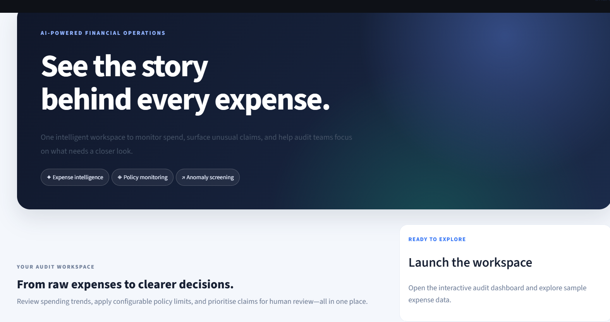
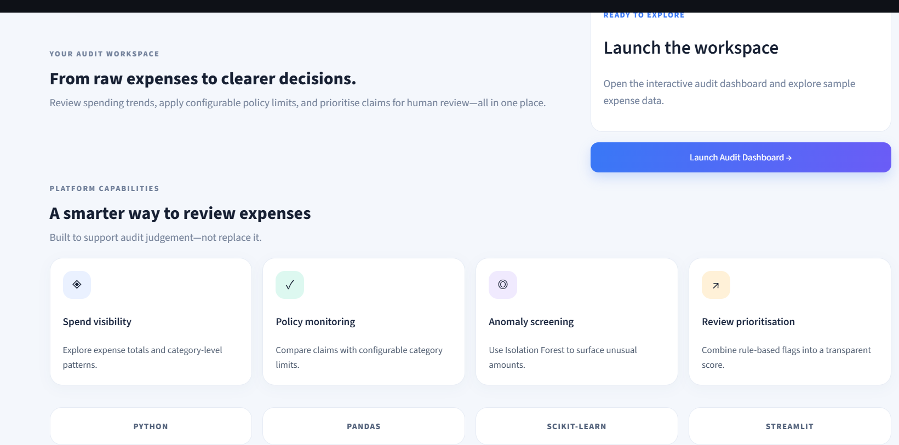
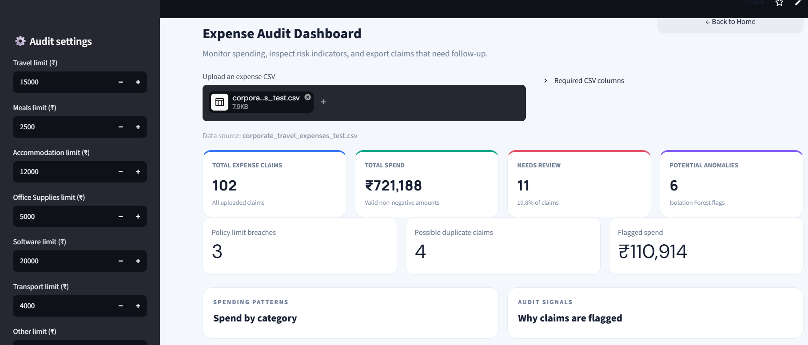
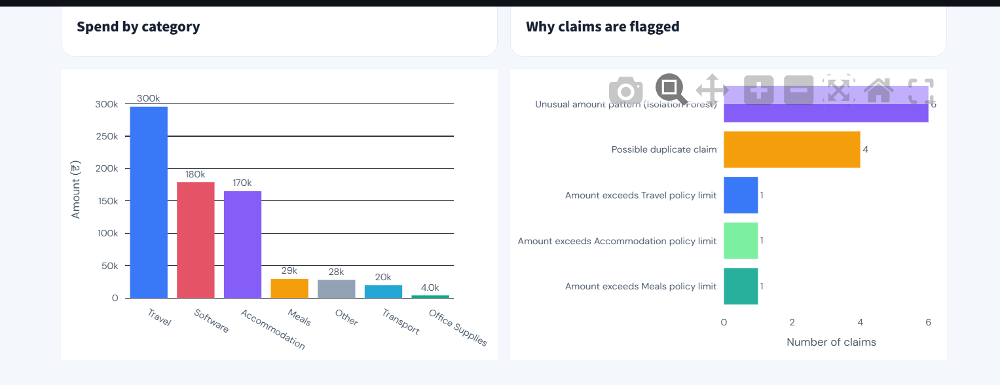
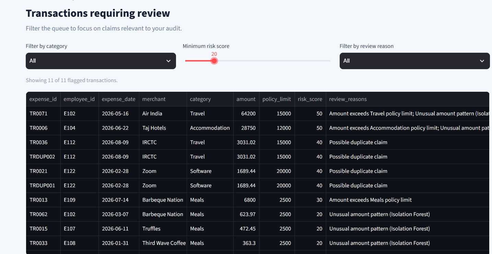
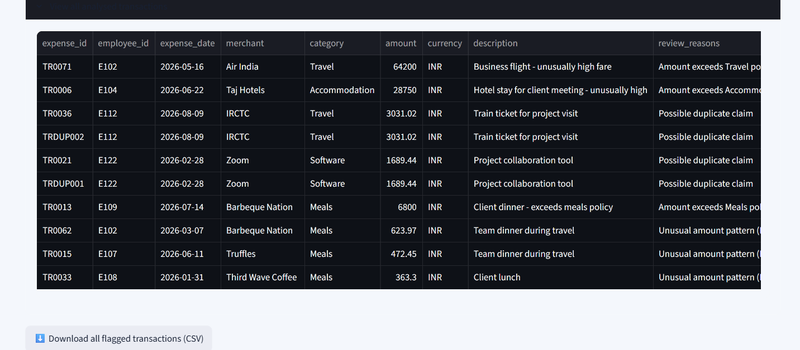

# AI-Powered Financial Audit & Expense Intelligence Platform

An interactive financial expense auditing platform built with Python and Streamlit to help identify unusual transactions, monitor expense policy violations, detect potential duplicates, and prioritize transactions for review.

## Live Demo

**[Launch the Financial Audit Dashboard](https://financial-audit-dashboard-33kgsuzwegmsldna6kotn.streamlit.app/)**

## Overview

Reviewing expense transactions manually can be time-consuming. This project combines data analytics, rule-based auditing, and machine-learning-based anomaly screening in an interactive dashboard.

Users can upload expense data, configure policy limits, explore flagged transactions, and export filtered results for further investigation.

## Key Features

- **Expense Analytics:** Explore transaction records and spending patterns through interactive metrics and visualizations.
- **Policy Monitoring:** Flag expenses that exceed configurable category limits.
- **Duplicate Detection:** Identify potentially duplicated transactions for further review.
- **Anomaly Detection:** Apply an Isolation Forest model to screen for unusual expense patterns.
- **Risk-Based Review:** Assign risk indicators and prioritize transactions that may need closer inspection.
- **Interactive Filtering:** Narrow the review queue using available transaction filters.
- **CSV Upload and Export:** Analyze uploaded expense datasets and export filtered review results.

## Technology Stack

- **Language:** Python
- **Dashboard:** Streamlit
- **Data Processing:** Pandas
- **Machine Learning:** Scikit-learn
- **Visualization:** Streamlit charts and data visualizations
- **Data Format:** CSV

## Getting Started

### Prerequisites

- Python installed on your computer
- Git installed
- A terminal or command prompt

### Installation

1. Clone the repository:

   ```bash
   git clone https://github.com/riyabajaj-23/financial-audit-dashboard.git
   ```

2. Open the project folder:

   ```bash
   cd financial-audit-dashboard
   ```

3. Create and activate a virtual environment (optional but recommended):

   **Windows PowerShell**
   ```powershell
   python -m venv .venv
   .\.venv\Scripts\Activate.ps1
   ```

4. Install the required packages:

   ```bash
   pip install -r requirements.txt
   ```

5. Start the dashboard:

   ```bash
   streamlit run app_redesigned.py
   ```

If your repository's final application entry point is `app.py` instead, use `streamlit run app.py`.

## Dataset

The repository includes a sample expense dataset for demonstrating the dashboard. Users can also upload compatible CSV files containing expense transaction records.

Use synthetic or appropriately anonymized financial data for demonstrations.

## Important Note

This application is designed as an expense-auditing and decision-support prototype. Anomaly flags and risk indicators are signals for human review, not proof of fraud or financial misconduct.

## Future Enhancements

- Integrate database-backed expense records.
- Add authentication and role-based access control.
- Develop more detailed audit reports.
- Track historical spending patterns and risk trends.
- Evaluate anomaly detection using labeled transaction data.

## Author

**Riya Bajaj**

[GitHub Profile](https://github.com/riyabajaj-23)

## 📸 Project Screenshots

### 1. Landing Page


### 2. Dashboard Overview


### 3. Expense Analytics


### 4. Audit Review Queue


### 5. Transaction Details


### 6. Export Details
